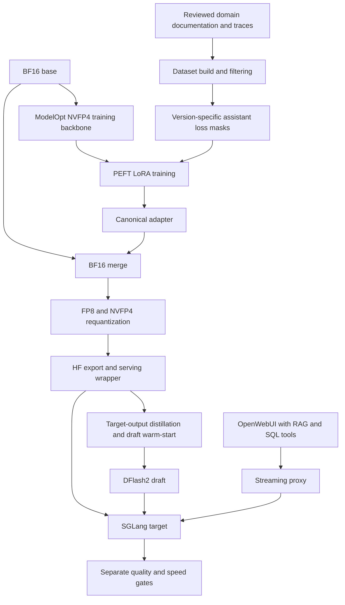

# Qwen 27B Domain Adaptation on DGX Spark

**NVFP4 QLoRA · Loss Masking · Teacher Traces · SGLang · DFlash2**

A single-machine engineering case study for a domain-aware business analytics assistant: align a 27B Qwen model with documented semantics and SQL tool workflows, then evaluate the trade-off between concise answers and longer analysis.

Archived v0.5 evaluation JSON records **5/5 knowledge checks, 6/6 SQL tool tasks, and 8/8 completed analysis tasks**, alongside **42.30 streaming decode tokens/s** in a separate speed gate. Longer analysis came at a cost: **425.6 seconds per analysis task on average**, versus 30.6 seconds for the v0.4 reference in that series. These small-suite results do not establish general accuracy or superior reasoning.

> Documentation draft · 2026-10-12 · 原始 v0.5 為已採用的 **Candidate，非 Production Release**。本作品尚待公開權利審查；本次未重跑模型或 SQL 評測。

## 1. Key Engineering Highlights

- **Quantized-backbone adaptation:** ModelOpt NVFP4 training backbone with frozen base weights and PEFT LoRA; kept separate from the serving checkpoint.
- **Version-aware loss masks:** v0.4 supervises reasoning closure, answers and tool calls; v0.5 masks legacy short reasoning while learning filtered teacher traces.
- **Long-trace training design:** chunked cross-entropy and activation checkpointing for a dataset whose longest analysis row contains 46,410 input tokens.
- **Deployment and draft alignment:** BF16 adapter merge → FP8/NVFP4 requantization → HF export → SGLang serving, with a warm-start DFlash2 draft aligned to the merged target.
- **Separate quality and performance gates:** knowledge, SQL tool use, analysis completion, decode throughput and task latency evaluated as different outcomes.

工程重點是資料、訓練格式、部署產物與驗測方法的整合。**QLoRA 適應模型行為；合併、量化與 SGLang／DFlash2 屬另一條推理優化流程，不能把推理加速直接歸因於微調。** 原始碼支持實作存在，不等於本次已執行驗證；證據類型與限制見 [Evaluation Method](docs/EVALUATION_METHOD.md)。

## 2. Hardware & Technology Stack

| Layer | Archived configuration |
|---|---|
| Hardware | One NVIDIA DGX Spark／GB10; 128 GB CPU/GPU unified memory |
| Base model | 27B Qwen; source identifier `Qwen/Qwen3.8-27B` **待核對** |
| Training | Custom PyTorch／PEFT loop; ModelOpt `0.47.0`, Transformers `5.18.0`, PEFT `0.21.1`; NVIDIA PyTorch `26.08-py3` |
| Adapter | LoRA rank 32, alpha 64, dropout 0.05; NVFP4 compressed backbone, BF16 activations |
| Long sequences | Chunked CE, checkpointing, token-budget micro-batching; archived fla-core version `0.5.2` |
| Deployment | BF16 merge; FP8 attention and NVFP4 MLP／lm_head requantization; HF checkpoint export |
| Inference & integration | SGLang `v0.5.21-cu130`, DFlash2／SpecForge, FP8 KV cache; OpenWebUI with RAG and SQL tools |

以上為封存環境紀錄。單台 GB10 的訓練、draft capture 與 serving 分階段使用資源，不假設能同時常駐所有模型；統一記憶體也不等於獨立 GPU VRAM。封存版本未由完整 runtime manifest 全部核對；模型身分、容器 digest 與量測缺件仍待補。

**模型命名待核對**：來源稱 Qwen3.8，config 卻使用 `Qwen3_5ForConditionalGeneration`／`qwen3_5`；需以模型卡、snapshot manifest 與權重 hash 確認，不能僅由類別名稱判定模型身分。

## 3. Training and Deployment Architecture

依來源重繪的抽象流程，省略公司資料與網路拓樸。RAG／SQL 為原始環境依賴，本作品未提供或呼叫這些服務。

訓練時只更新 LoRA adapter；部署時合併回 BF16 後重新量化，再對 target 輸出蒸餾與 warm-start draft。訓練用 NVFP4 checkpoint 不是可直接交給 SGLang 的產物，NVFP4 也不可與 bitsandbytes NF4 混稱。

v0.5 build report 記錄 **5,134 rows／5,043,275 input tokens**，包括 103 條教師分析與 100 條教師知識資料；rows 含舊資料重複，不代表同數量的獨立新案例。訓練時間約 **v0.4 7.8 h／v0.5 11.7 h，均為封存紀錄值**，缺完整訓練 log，未在本機重現。v0.4 所報 2,552 rows 與敘事組成合計 2,555 不一致，**資料筆數待核對**。詳細 mask、配比、steps 與資源取捨見 [工程歷程](docs/ENGINEERING_JOURNEY.md)。

## 4. Evaluation Results

### Series A — v0.4 deployment configurations · 2026-10-08

| Configuration | Decode tok/s | Knowledge checks | SQL tool tasks | SQL suite time |
|---|---:|---:|---:|---:|
| v0.4 runtime LoRA | 27.01 | 5/5 | 4/6 | 130 s |
| v0.4 merged + old draft | 45.14 | 4/5 | 5/6 | 130 s |
| v0.4 merged + new draft | **49.63** | **4/5** | **6/6** | **109 s** |

取自原始 gate JSON；保留自動評分 4/5，不以敘事中的「實質 5/5」覆蓋。此表比較完整部署配置，未分離合併、量化、kernel 與 draft 的個別貢獻。

### Series B — v0.5 analysis evaluation · 2026-10-09–10

| Configuration | Decode tok/s | Knowledge checks | SQL tool tasks | Analysis completed | Mean analysis latency |
|---|---:|---:|---:|---:|---:|
| v0.4 reference | 36.19 | 5/5 | 5/6 | 8/8 | **30.6 s** |
| v0.5 + old draft | 38.53 | 5/5 | 6/6 | 8/8 | 333.6 s |
| v0.5 + new draft, final | **42.30** | **5/5** | **6/6** | **8/8** | **425.6 s** |

final v0.5 深度題平均報告 3,432.2 字元、工具呼叫 12.5 次；v0.4 reference 分別為 401.1 字元、2.0 次。**較長輸出、更多工具呼叫與 8/8 答完，不等於更高準確率或更強通用推理能力。** 延遲是深度題平均完整耗時，decode 則來自另外的 speed gate；兩者不能互換。

**Benchmark conditions and comparability**

- **Small internal Golden Set:** know5 用 regex 判分，agent6 比對數字／名稱與工具格式，depth8 記錄完成與行為指標；不是通用 Accuracy Benchmark。原始 SQL 結果依賴公司環境，本次只核對封存 JSON。
- **Decode ≠ end-to-end latency:** speed gate 為 5 題 holdout＋3 題長輸出，temperature=0；排除短題達 2,048 tokens 上限的輸出，aggregate 只納入 tokens >16 的有效樣本，以 Σ(tokens−1)／Σ串流生成區間計算。TTFT 不含前置 RAG 時間。
- **Do not compare A directly with B:** 來源稱 A 為短 Prompt、B 為 deployed-context；封存 `speed()` 卻只組合知識指令與 RAG，缺逐 run request／腳本版本，**Prompt 差異待核對**。保留分組，不將 49.63 與 42.30 直接當成版本退步。
- **No generalization claim:** 單輪小題組、選版反覆接觸題目、舊資料相似題僅記錄不剔除，以及缺多輪、負載、冷暖快取／信賴區間，都限制結論。判分版本差異與驗測限制見 [Evaluation Method](docs/EVALUATION_METHOD.md)。

## 5. Engineering Challenges & Lessons Learned

| Challenge | Engineering response | Lesson |
|---|---|---|
| Repetition and unfinished reasoning | v0.4 納入 reasoning／`</think>` 監督；分段 tokenize 對齊 generation prefix | Loss 邊界是行為設計；沒有單因素消融，不把所有改善歸因於 mask |
| Fast answers with shallow analysis | v0.5 遮罩舊短 reasoning、過濾 teacher traces、保留答案監督 | 教師也會錯；分析深度與 latency 必須一起驗收 |
| Long traces on unified memory | Chunked CE＋checkpointing、最長 row 記憶體 probe | 以額外計算換記憶體；probe 數值缺原始 log，不能當已重現成果 |
| Draft metrics did not predict serving speed | 明確 warm-start；掛上 target 實測 checkpoint | Teacher-forced 指標不能代替真實 decode 測試 |
| False readiness and broken streaming | 真實 completion 就緒檢查；proxy buffering／timeout、reasoning／tool parser 修正 | 傳輸、parser、模型品質與 decode 效能要分開診斷 |

完整的 v0.1～v0.5 失敗、根因假設與修改結果保留於 [Engineering Journey](docs/ENGINEERING_JOURNEY.md)，原始證據另行私下保存。

## 6. My Contributions & AI-Assisted Development

**Role: Project Owner — Technical Direction, Solution Selection & Evaluation**

This project was developed through an AI-assisted engineering workflow, combining my enterprise IT experience and technical decision-making with implementation support from Claude Code.

**My responsibilities included:**

- Defined project objectives, business requirements, and expected model behavior.
- Identified practical problems through model usage, including response quality, reasoning depth, inference latency, and enterprise workflow reliability.
- Discussed possible technical solutions with Claude Code, evaluated proposed alternatives, and selected the approaches to pursue.
- Directed subsequent experiments and reviewed reported test results and model behavior to determine further improvements.
- Guided the project toward practical enterprise AI use cases, drawing on my experience with ERP systems, business data, and IT architecture.

**AI-assisted implementation:**

Claude Code was responsible for most hands-on implementation activities, including Python development, model training scripts, environment configuration, execution, and debugging.

I did not manually develop the underlying training code. My primary contributions were defining requirements, selecting technical approaches, providing feedback, and guiding iterative development.

Codex was subsequently used to review archived technical evidence and prepare this portfolio documentation.

**Engineering approach:**

The project demonstrates how AI coding agents can support complex LLM engineering workflows when combined with human-defined objectives, technical decision-making, experimental feedback, and evidence-based evaluation.

Performance measurements and technical findings are documented separately with their original evidence and limitations.

## 7. Limitations & Reproducibility

此版為**文件型案例**，不附內部資料、原始腳本、模型權重或公司 endpoint；Windows 本機沒有重現 GB10 訓練與評測。程式實作、封存結果、因果假設與規劃事項的區分詳見 [Evaluation Method](docs/EVALUATION_METHOD.md)。

完整 training summaries、量化 report、artifact hashes、模型命名、資料計數與 Prompt 條件仍待補核；沒有主張量化無損或全面優於 RAG-only。公開前需分別確認程式、文件、資料、架構圖與套件／模型授權。

公開可重現範例為**規劃中**：先補去識別化 manifests 與版本鎖定，再經授權以合成資料、mock SQL 與獨立相容環境驗證；不連線原公司服務。

## 8. Detailed Documentation

| Read next | What it covers |
|---|---|
| [Engineering Journey](docs/ENGINEERING_JOURNEY.md) | v0.1–v0.5 experiments, failures, loss masks, teacher data and deployment decisions |
| [Evaluation Method](docs/EVALUATION_METHOD.md) | Golden Set design, speed measurements, archived summaries and reproducibility limits |
