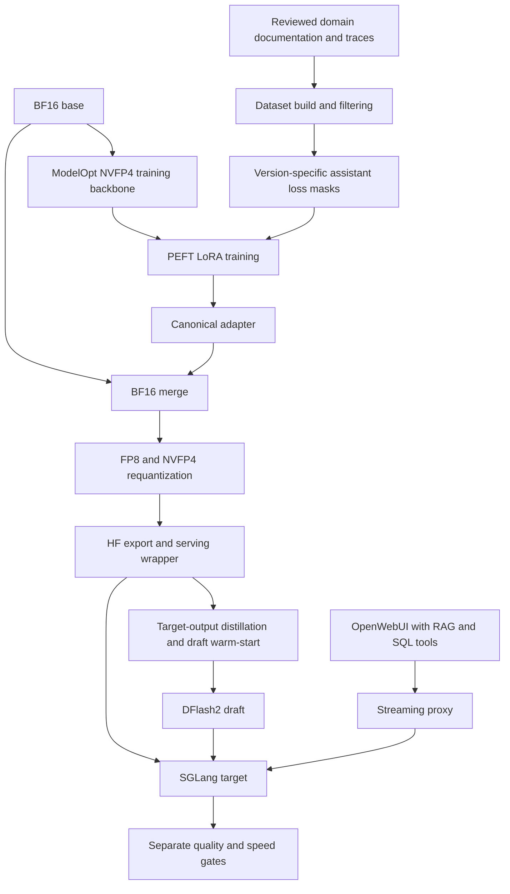

# Qwen 27B Domain Adaptation on DGX Spark

**NVFP4 QLoRA · Loss Masking · Teacher Traces · SGLang · DFlash2**

A single-machine engineering case study for a domain-aware business analytics assistant: align a 27B Qwen model with documented semantics and SQL tool workflows, then evaluate the trade-off between concise answers and longer analysis.

Archived v0.5 gates record **5/5 knowledge checks, 6/6 fixed SQL tool tasks, and 8/8 completed analysis tasks**, with **42.30 streaming decode tokens/s under the earlier reasoning parser**. After the parser update, the recorded regression run retained 5/5 and 6/6 and measured 39.83 tok/s; analysis tasks were not rerun. The earlier analysis gate averaged **425.6 seconds per task**, versus 30.6 seconds for its v0.4 reference. These single-run, small-suite results establish neither general accuracy nor a speed advantage over v0.4.

> 2026-10-12 · 本作品為經去識別化整理的個人 AI 工程案例，僅提供技術說明、抽象架構與模型測試彙總，不提供企業原始碼、資料、SQL 或內部部署設定。實驗結果依據封存紀錄，保留原有測試條件與已知限制；不代表正式 Production Release。

v0.5 為 **Adopted Candidate，僅內部試用，未經 Production 驗收或 Promotion 核准**。本次依原開發 Agent 的封存證據查核修正文案，未重跑模型或 SQL 評測。

## Extended Evaluation — 2026-10-13

The archived v0.5 follow-up examines the **complete assistant stack (system instructions, retrieval and possible tools), not LoRA alone**. It adds a **39-case acceptance suite (37 PASS / 2 PARTIAL)**, a **100-case near-distribution development suite (91 PASS / 4 PARTIAL / 5 FAIL)**, multi-turn checks, long-context retrieval probes and fixed-length concurrent-generation measurements on one DGX Spark / GB10.

In a synthetic 512-token, reasoning-OFF concurrency test, **eight streams produced 110.8 aggregate tokens/s**, while the worst observed TTFT at 32 streams reached **83.32 seconds**. These are **aggregate, test-specific observations**, not single-user output speeds or validated production capacity. The graded suites used **one AI-assisted reviewer**; the final holdout was not scored and has known training overlap.

- **[Extended evaluation research report](docs/EXTENDED_EVALUATION_20261013.md)** — methods, quality and latency trade-offs, and failure categories.
- **[Interactive dashboard (offline HTML + aggregate JSON)](docs/public-dashboard/README.md)** — inspect the de-identified charts and source data. A live Pages link will be added after site deployment.

## 1. Key Engineering Highlights

- **Quantized-backbone adaptation:** all five versions train PEFT LoRA on a frozen uniform-NVFP4 technical smoke backbone; deployment is a separate BF16 merge and requantization path.
- **Version-aware loss masks:** v0.4 supervises reasoning closure, answers and tool calls; v0.5 masks legacy short reasoning while learning filtered teacher traces.
- **Long-trace training design:** chunked cross-entropy and activation checkpointing for a dataset whose longest analysis row contains 46,410 input tokens.
- **Deployment and draft alignment:** BF16 adapter merge → FP8/NVFP4 requantization → HF export → SGLang serving, with a warm-start DFlash2 draft aligned to the merged target.
- **Separate quality and performance gates:** knowledge, SQL tool use, analysis completion, decode throughput and task latency evaluated as different outcomes.

工程重點是資料、訓練格式、部署產物與驗測方法的整合。**QLoRA 適應模型行為；合併、量化與 SGLang／DFlash2 屬另一條推理優化流程，不能把推理加速直接歸因於微調。** 原始碼支持實作存在，不等於本次已執行驗證；證據類型與限制見 [Evaluation Method](docs/EVALUATION_METHOD.md)。

## 2. Hardware & Technology Stack

| Layer | Archived configuration |
|---|---|
| Hardware | One NVIDIA DGX Spark／GB10; 128 GB CPU/GPU unified memory |
| Base model | `Qwen/Qwen3.8-27B` · BF16 · revision `1d4bf0f2ff6012fd82039f2fa52739d0dd7c60c0` |
| Architecture | `Qwen3_5ForConditionalGeneration`／`qwen3_5`; 64 text layers: 48 linear-attention + 16 full-attention |
| Training | Custom PyTorch／PEFT loop; ModelOpt `0.47.0`, Transformers `5.18.0`, PEFT `0.21.1`; NVIDIA PyTorch `26.08-py3` |
| Adapter | Rank 32, alpha 64, dropout 0.05; ModelOpt `NVFP4_DEFAULT_CFG` uniform-NVFP4 training backbone, BF16 activations |
| Long sequences | Chunked CE, checkpointing, token-budget micro-batching; archived fla-core version `0.5.2` |
| Deployment | BF16 merge; Local-Hessian requantization; 208 FP8 + 193 NVFP4 layers; self-built serving checkpoint |
| Inference & integration | SGLang `v0.5.21-cu130`, DFlash2／SpecForge, FP8 KV cache; OpenWebUI with RAG and SQL tools |

以上模型來源、訓練記錄與 serving 版本已由原開發 Agent 對照原件查核，本次依去識別化結論整理。單台 GB10 的訓練、draft capture 與 serving 分階段使用資源；統一記憶體不等於獨立 GPU VRAM。完整版本鎖定與訓練表見 [工程歷程](docs/ENGINEERING_JOURNEY.md)。

**模型識別與實作類別分開看**：確認的模型 repo 是 Qwen3.8，上述 `qwen3_5` 是架構實作名稱，不能因此改稱 Qwen3.5。官方對命名關係的說明未找到，不推測原因。量化比對來源為 `nvidia/Qwen3.8-27B-NVFP4`，revision `482ca0f3832238542f8f5295dde86b5f22711d80`；本案 serving 權重是自行合併、校準與重新量化，不是官方權重的同一份副本。

## 3. Training and Deployment Architecture

依來源重繪的抽象流程，省略公司資料與網路拓樸。RAG／SQL 為原始環境依賴，本作品未提供或呼叫這些服務。

v0.1～v0.5 都在以 `NVFP4_DEFAULT_CFG`、32 筆校準建立的 uniform NVFP4 **Technical Smoke Backbone** 上訓練。它僅用於技術驗證：原治理禁止將 backbone 作為 Production base／正式推論服務，並禁止由其訓練的 adapter Promotion。v0.4 起服務的是 adapter 合併回 BF16 後重新量化的模型，而非直接部署訓練 backbone；訓練與服務量化格式不同。未找到正式解除決議，合併不代表自動取得 Production／Promotion 資格。NVFP4 不可與 bitsandbytes NF4 混稱。

v0.5 為 **5,134 rows／5,043,275 input tokens／1,429,800 supervised tokens**；rows 含舊資料重複。教師分析由合格 154 條隨機抽 120，再剔除超過 48k tokens 的 17 條，留下 103，另有教師知識 100 條。v0.4 實際為 **2,552 rows**：名目 2,555 因一題改寫生成失敗少 2 條、相似題過濾再少 1 條。訓練 summary、metrics 與 log 查核確認 v0.4 **638 steps／2 epochs／7.76 h**，v0.5 **642 steps／1 epoch／11.68 h**；均為封存實測，非本機重現。詳細 loss、記憶體與資料分布見工程歷程。

## 4. Evaluation Results

### Series A — v0.4 deployment configurations · 2026-10-08

| Configuration | Decode tok/s | Knowledge checks | SQL tool tasks | SQL suite time |
|---|---:|---:|---:|---:|
| v0.4 runtime LoRA | 27.01 | 5/5 | 4/6 | 130 s |
| v0.4 merged + old draft | 45.14 | 4/5 | 5/6 | 130 s |
| v0.4 merged + new draft | **49.63** | **4/5** | **6/6** | **109 s** |

取自原始 gate JSON。知識題自動 4/5 中的一題因關鍵詞規則未涵蓋同義說法而失敗，人工判讀內容正確；仍保留自動分數。此表比較完整配置，未分離各優化的個別貢獻。**同一 v0.4 合併模型在 Series A 與 B 分別測得 49.63、36.19 tok/s；不能把其中一次當成穩定代表值。**

### Series B — v0.5 analysis evaluation · 2026-10-09–10

| Configuration | Decode tok/s | Knowledge checks | SQL tool tasks | Analysis completed | Mean analysis latency |
|---|---:|---:|---:|---:|---:|
| v0.4 reference | 36.19 | 5/5 | 5/6 | 8/8 | **30.6 s** |
| v0.5 + old draft | 38.53 | 5/5 | 6/6 | 8/8 | 333.6 s |
| v0.5 + new draft, earlier-parser final gate | **42.30** | **5/5** | **6/6** | **8/8** | **425.6 s** |

上表 v0.5 final 使用舊 reasoning parser `deepseek-r1`；改成 `qwen3` 後的存檔回歸結果為 **39.83 tok/s、知識 5/5、固定 SQL 題 6/6，深度題未重跑**。舊 parser 深度題平均報告 3,432.2 字元、工具呼叫 12.5 次；v0.4 reference 為 401.1 字元、2.0 次。**6/6 只表示固定題組通過，8/8 只表示產出最終報告、未評內容正確性。** 深度題耗時與另一個 speed gate 的 decode 不能互換；較長輸出不等於更高準確率。

**Benchmark conditions and comparability**

- **Small internal Golden Set:** know5 用 regex 判分，agent6 比對數字／名稱與工具格式，depth8 記錄完成與行為指標；不是通用 Accuracy Benchmark。原始 SQL 結果依賴公司環境，數據依封存結果與後續工程查核整理，本次未執行評測。
- **Same speed prompt construction:** 兩系列 `speed()` 都使用知識指令＋RAG 檢索結果，不含部署 System Prompt；部署 Prompt 另用於 SQL 與深度題。速度題為固定 30 題問題池的前 5 題＋3 題長輸出，不是 134 題 Final Holdout。temperature=0，max_tokens 分別 2,048／800；RAG 在計時前完成。
- **Single-run decode metric:** 每個配置只測一次、單串流，以 Σ(tokens−1)／Σ有效串流生成時間計算；排除短題達上限及 tokens ≤16 的樣本，不含 TTFT。輸出長度不一致：同一 v0.4 的第 8 題在兩次測速分別輸出 800 與 90 tokens。沒有單變因控制，不能判定速度差的原因或宣稱 v0.5 較快。
- **No held-out accuracy claim:** Final Holdout 134 題中有 **3 題（2.2%）**與訓練問題完全相同，尚未用於評分；近似重疊統計為 **NOT TESTED**。知識 5 題中有 3 題屬刻意訓練過的主題。完整隔離與量測限制見 [Evaluation Method](docs/EVALUATION_METHOD.md)。

## 5. Engineering Challenges & Lessons Learned

| Challenge | Engineering response | Lesson |
|---|---|---|
| Repetition and unfinished reasoning | v0.4 納入 reasoning／`</think>` 監督；分段 tokenize 對齊 generation prefix | Loss 邊界是行為設計；沒有單因素消融，不把所有改善歸因於 mask |
| Fast answers with shallow analysis | v0.5 遮罩舊短 reasoning、過濾 teacher traces、保留答案監督 | 教師也會錯；分析深度與 latency 必須一起驗收 |
| Long traces on unified memory | Chunked CE＋checkpointing、最長 row 記憶體 probe | 原始 log 確認單一樣本 CE 一致；probe 78.04 GiB 與訓練峰值 80.54 GiB 不混用 |
| Draft metrics did not predict serving speed | 明確 warm-start；掛上 target 實測 checkpoint | Teacher-forced 指標不能代替真實 decode 測試 |
| False readiness and broken streaming | 真實 completion 就緒檢查；proxy buffering／timeout、reasoning／tool parser 修正 | 傳輸、parser、模型品質與 decode 效能要分開診斷 |

完整的 v0.1～v0.5 失敗、根因假設與修改結果保留於 [Engineering Journey](docs/ENGINEERING_JOURNEY.md)，原始證據另行私下保存。

## 6. My Contributions & AI-Assisted Development

**Role: Project Owner — Technical Direction, Solution Selection & Evaluation**

This project was developed through an AI-assisted engineering workflow, combining my enterprise IT experience and technical decision-making with implementation support from Claude Code.

**My responsibilities included:**

- Defined project objectives, business requirements, and expected model behavior.
- Identified practical problems through model usage, including response quality, reasoning depth, inference latency, and enterprise workflow reliability.
- Discussed possible technical solutions with Claude Code, evaluated proposed alternatives, and selected the approaches to pursue.
- Directed subsequent experiments and reviewed reported test results and model behavior to determine further improvements.
- Guided the project toward practical enterprise AI use cases, drawing on my experience with ERP systems, business data, and IT architecture.

**AI-assisted implementation:**

Claude Code was responsible for most hands-on implementation activities, including Python development, model training scripts, environment configuration, execution, and debugging.

I did not manually develop the underlying training code. My primary contributions were defining requirements, selecting technical approaches, providing feedback, and guiding iterative development.

Codex was subsequently used to review archived technical evidence and prepare this portfolio documentation.

**Engineering approach:**

The project demonstrates how AI coding agents can support complex LLM engineering workflows when combined with human-defined objectives, technical decision-making, experimental feedback, and evidence-based evaluation.

Performance measurements and technical findings are documented separately with their original evidence and limitations.

## 7. Limitations & Reproducibility

此版為**文件型案例**，不附內部資料、原始腳本、模型權重或公司 endpoint；Windows 本機沒有重現 GB10 訓練與評測。程式實作、封存結果、因果假設與規劃事項的區分詳見 [Evaluation Method](docs/EVALUATION_METHOD.md)。

原件查核已確認模型來源、資料計數、訓練 summaries、量化層級與運行版本。仍缺因果消融、多樣本 CE 對照、raw SSE、多輪／併發／冷暖快取測試、Final Holdout 近似重疊及評分、parser 更新後深度評測與思考開關矩陣原件。沒有主張量化無損、v0.5 更快或全面優於 RAG-only；模型仍未獲 Production／Promotion 核准。

公開可重現範例為**規劃中**：先補去識別化 manifests 與版本鎖定，再經授權以合成資料、mock SQL 與獨立相容環境驗證；不連線原公司服務。

## 8. Detailed Documentation

| Read next | What it covers |
|---|---|
| [Engineering Journey](docs/ENGINEERING_JOURNEY.md) | v0.1–v0.5 experiments, failures, loss masks, teacher data and deployment decisions |
| [Evaluation Method](docs/EVALUATION_METHOD.md) | Golden Set design, speed measurements, archived summaries and reproducibility limits |
